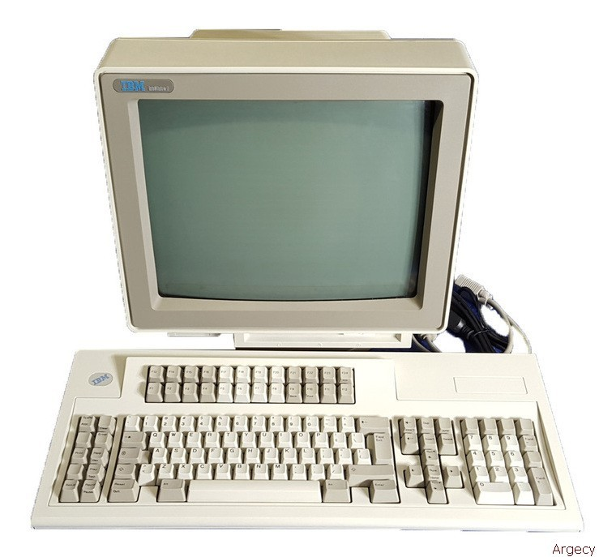

# IBM InfoWindow twinax terminal (3477 / 3486) in the browser

This project keeps the IBM 3477 and IBM 3486 InfoWindow 5250 display
stations alive as a web app. It runs the terminals' **original firmware
unmodified** in a Go 8088 emulator and shows the result in a browser.
The twinax cable to the AS/400 is replaced by **TN5250 over TCP/IP**:
you enter a host name or IP address and a port, like in
[web5250](../web5250).

## The terminal we emulate



This is the **IBM 3477 InfoWindow**, the terminal this project emulates.
It is a 5250 display station that connects to an AS/400 over twinax
cable. Its screen shows 24×80 or 27×132 characters, and it comes with
the 122-key IBM 5250 keyboard: 24 function keys, a block of command keys
on the left and a numeric keypad. The emulator runs its original
firmware, so the screen, the indicators and even the keyboard click
behave like the real one shown above.

```
browser keys -> emulated keyboard -> terminal ROM -> twinax poll response
             -> workstation-controller bridge -> TN5250 -> host
host -> bridge -> twinax station commands -> terminal ROM -> video RAM
     -> browser
```

A twinax terminal never sees the 5250 data stream directly. The
workstation controller handles fields, translates keystrokes and produces
AID keys, then drives the terminal with low-level station commands (Poll,
Write Data and Load Cursor, Load Address Counter, ...). The bridge in this
project therefore emulates that controller.

## Status

The plan has six stages; the first one is complete:

| Stage | What | State |
|---|---|---|
| 0 | ROM analysis tools, listings, checksums | done |
| 1 | 8088 CPU core: passes all 2,897,000 SingleStepTests 8088 cases | done |
| 2 | 3477 boots: memory map and gate-array stubs until POST passes | in progress (POST reaches test 3) |
| 3 | Video (CRTC, video RAM) and keyboard, shown live in the browser | in progress (font, cells and keyboard work) |
| 4 | Twinax station engine and workstation-controller bridge | engine passes POST tests 3/4; controller built and unit-tested |
| 5 | TN5250 end to end (copied from web5250) | host side works (pub400.com sign-on screen received); waits for POST to finish |
| 6 | 3486 model, which needs a complete ROM dump (see below) | blocked |

## ROM files

The ROMs are IBM firmware and are **not** committed to the repository
(see `.gitignore`). Keep them in the project directory:
`build.bash` embeds them into the binaries from there. Note
that distributing the binaries therefore distributes IBM's firmware.

| File | Size | Maps to | State |
|---|---|---|---|
| `ibm3477_part2.bin` | 128K | C0000-DFFFF | complete (word sums 1234, 5678) |
| `ibm3477_part1.bin` | 128K | E0000-FFFFF | complete (word sums 9ABC, DEF0) |
| `3486.bin` | 512K | 80000-FFFFF | **partial**: A17 was stuck high |

### Why the 3486 dump is unusable for now

The 3486 ROM was read as a 27C040 while the chip's A17 input was stuck
high. Every 64K block therefore appears twice (A B A B C D C D), and the
file contains only segments **A000, B000, E000 and F000**. Segments
8000, 9000, C000 and D000 are missing. The firmware checks itself by
summing the 16-bit words of 80000-FFFFF and expecting **0x619A** (table
at F000:2B97); this dump fails that check. POST also ends with a jump
into the missing D000 segment. A correct re-dump has to pass that
word-sum. The emulator will refuse a 3486 ROM that fails it.

## Hardware (worked out from the ROMs)

Both models share the same design (the 3477 board per MAME's
`ibm3477.cpp` notes: AMD N8088-2, two IBM gate arrays, 64K SRAM):

- **CPU:** 8088. The firmware uses only 8086 instructions and almost no
  I/O ports; all hardware is memory-mapped.
- **I/O gate array at 0x20000:**
  - interrupt mask at 0x20004 (word), plus enable and acknowledge bytes;
  - model straps (0x2000A), error/LED code (0x20010);
  - keyboard port at 0x20012-0x20014, AT-style protocol;
  - beeper (0x20015);
  - twinax line test (0x20020-0x2002B).
- **Video gate array (CRTC) at 0x20100:**
  - mode timing registers;
  - vsync status (0x2012F bit 3), cursor and an address engine.
- **Video RAM:** from 0x08000, with separate planes for characters and
  attributes.
- **Twinax:** per-station control blocks in low RAM (0x180, 0x190, ...)
  with DMA.
- **Font:** the character-generator font is not in either ROM, so cells
  are drawn with a web font.

## Tools

The tools need Python 3 with `capstone` (`pip install capstone`).

```sh
# 3477 listing (verifies the per-segment checksums first)
python3 tools/disasm3486.py --model 3477 --listing 3477.listing \
        ibm3477_part2.bin ibm3477_part1.bin

# 3486 listing of the partial dump, plus the de-duplicated 256K image
python3 tools/disasm3486.py --model 3486 --listing 3486.listing \
        --image-out 3486_partial_ABEF.bin 3486.bin

# tests
python3 tools/test_disasm3486.py --model 3477 --listing 3477.listing \
        ibm3477_part2.bin ibm3477_part1.bin
python3 tools/test_disasm3486.py --model 3486 --listing 3486.listing \
        --image 3486_partial_ABEF.bin 3486.bin
```

The disassembler starts at the reset vector and follows code from there
(recursive descent). It then adds routine entries marked by `EB 00`, and
finally guessed entries after `ret`/`jmp` or `0xCC` filler. A guess is
kept only if it decodes cleanly, contains no 80186+ or implausible
opcodes, and every path ends properly; guessed entries are labelled
`ent_*`. Bytes it cannot reach are listed as `db`.

## Building and running

```sh
./build.bash                # macOS universal, Linux amd64, Linux arm64
```

The script embeds the ROMs, runs `go vet` and the tests, then builds into
`bin/` (`bin/<name>-<version>-<target>`). It also copies the macOS
universal binaries to `bin/webibm3477` and `bin/appwebibm3477`.
The two programs are:

| Binary | Purpose |
|---|---|
| `bin/webibm3477` | Multi-user server. Every browser tab gets its own emulated terminal. |
| `bin/appwebibm3477` | Desktop app. Serves only this computer (`127.0.0.1:53477`), opens the browser by itself, and quits about 30 seconds after the last tab closes. The URL carries a per-run secret, so other web pages cannot use the terminal. |

```sh
./bin/webibm3477 -listen :8050 -romdir . -host pub400.com -port 23
./bin/appwebibm3477                 # finds the ROMs in . or next to the binary
./bin/appwebibm3477 -no-browser     # just print the URL (e.g. over ssh -L)
```

On a server open to the internet, start `webibm3477` with `-lock`.
Otherwise any visitor can make the server open TCP connections to any
host and port, including addresses on its internal network. With
`-lock`, every terminal connects only to `-host`:`-port`, and `-host`
must be given explicitly. The page shows that host and port and does
not let visitors change them. `appwebibm3477` has no `-lock`: it only
serves the local computer.

```sh
./bin/webibm3477 -listen :8050 -host pub400.com -port 23 -lock
```

In the page you choose the terminal model (3477 or 3486), switch it on,
and enter the host, port and screen size. The screen size is the
terminal type the TN5250 session announces to the host:
- 24×80 announces `IBM-3179-2`;
- 27×132 announces `IBM-3477-FC`.

The 3486 is locked to 24×80. The screen itself is drawn from the
terminal's own video RAM and font RAM, and key presses go to the
emulated keyboard.

The IBM 3477 ROMs are **built into the binaries**: the build script
embeds them, so the programs run anywhere without ROM files.
- `-romdir DIR` loads ROMs from a directory instead.
- A binary built without embedded ROMs looks in the current directory,
  then next to the program, then one directory up.
- The partial 3486 dump is not embedded, because it cannot boot.

Current state: the 3477 powers on and passes its RAM, ROM and twinax
self-tests; POST now stops at test 5 (the video self-test). **Connect**
opens the TN5250 session and attaches the emulated workstation
controller, but the terminal answers on twinax only once its firmware
finishes POST and starts its run-time driver.

## Documentation

- [MEMORY.md](MEMORY.md): every known RAM, ROM and hardware address and
  what it contains.
- [INTERRUPTS.md](INTERRUPTS.md): the interrupt system.
- [TWINAX.md](TWINAX.md): the twinax station engine and the emulated
  workstation controller.
- [NVRAM.md](NVRAM.md): the non-volatile setup memory and its format.
- [PRINTER.md](PRINTER.md): the printer port, its data, and printing.

The terminal's setup is kept in `~/.config/ibm3477/nvram.bin` (or
`$XDG_CONFIG_HOME/ibm3477/nvram.bin`). It is created on first start
with: One-Display, display addresses 0/0, Country Specific character
set, printer address 0, printer character set PC, printer emulation 5256,
and serial number 78-1234567. Changes made in Setup are saved to that
file.

### Browser settings

Settings › Display sets the text colour: IBM Green (default), Amber or
White, and switches the sound on or off. The sound is the terminal's
own speaker as its firmware drives it: a key click, the alarm when the
host or an input error asks for one, and a short beep at power-on.
Browsers play audio only after a key press or click on the page. The
volumes are the terminal's Setup choices; the pitch (1 kHz) is a guess.
"Mute keyboard click" silences the click only; the alarm still sounds.
"Keyboard click" chooses between:
- **Synthetic**: a short 3 kHz click with a hollow resonance.
- **Realistic**: recordings of a real IBM 3477 and its 122-key keyboard,
  one of four keystrokes at random for each key. The recordings were cut
  from a video at leela.pocnet.net/~poc/3477.mov (0:34–0:45). They hold
  only the buckling-spring clack: a narrow 3,520 Hz tone that comes with
  just a third of the key presses in the video, and the room's background
  tones, were filtered out.

The browser remembers the last host and port, the terminal model and
size, the codepage, the text colour, the sound switch, the click mute
and the keyboard mapping (`localStorage`), so they are back after a
browser restart.

### Keyboard

The emulated keyboard is the 3477's 122-key keyboard, US English. The
terminal sends its keys to the controller as 5250 twinax key codes; see
TWINAX.md. Default PC keys: F1-F12 = PF1-PF12, Shift+F1-F12 =
PF13-PF24, Page Up/Down = Roll Down/Up, Escape = Reset, right Alt or
Enter = Enter, End = Field Exit. All of them can be changed in Settings ›
Keyboard Mapping.

### 3270 (SNA) hosts are refused

This terminal speaks 5250 only. A host that turns out to be an IBM
mainframe behind TN3270 (SNA/VTAM) is hung up on at once, with "Refused:
… is a 3270 (SNA) host" in the status bar. It is recognized in one of
two ways:
- it asks for the TN3270E telnet option (40), which a 5250 host never
  does;
- its first data record lacks the 5250 record header (type 12A0), as a
  3270 Erase/Write does.

### Printing

While connected to a host, the **Print key** (Ctrl+P by default) prints
a copy of the screen (Settings › Print key: "Local copy"), or asks the
host to print it ("Send to host").
- With Terminal Mode **Display-Printer** in the terminal's Setup (and a
  Printer Address different from the display's), the copy goes to the
  terminal's own printer: the 3477 formats it with its Setup Printer
  choices and sends it to its printer (IBM Proprinter commands). The
  emulator collects that; when the printer has been quiet for 2 seconds
  the print job is ready. Print jobs the host sends to that printer will
  print the same way (planned).
- In the other modes the emulator makes the print job from the screen
  directly (10 characters, 6 lines per inch).

The page then shows the print job:
- **Save as PDF / text:** in Chrome and Brave you name the file and
  choose the folder; other browsers download it.
- **Print on:** one of this computer's printers (CUPS on macOS and
  Linux). `webibm3477 -lock` does not offer the server's printers.
- **Open PDF to print:** a new tab with the PDF and the browser's own
  print dialog.

Settings › Print jobs (or "Do this every time") makes one of these
automatic. The Setup Printer choices (lines and characters per inch,
quality, character height) shape the output, as on a real 3477; see
PRINTER.md.

### Mouse, copy and paste

- A click on the screen moves the cursor there (while connected).
- Dragging selects a rectangle; ⌘C (macOS) or Ctrl+C copies it. Password
  fields are never copied.
- ⌘V or Ctrl+V types the clipboard into the terminal, one character
  every 10 ms (the browser asks no clipboard permission):
  - Characters on the US keyboard are typed as keys, so the terminal and
    the controller apply their usual field rules.
  - Other characters (ä, ö, ü, ß, é, …) go straight to the host session,
    in order.
  - Line breaks become New Line, tabs Tab.
  - A paste stops at the first character the field rejects, as typing
    would.
  - Pasted characters make no key click; only typing clicks.

### Entering Setup

The terminal has two setup menus, as on a real 3477:

| Menu | How to open it | What it offers |
|---|---|---|
| **Offline Setup** | Press **any key right after ⏻ Power on**, before the IBM logo appears (within about 3 seconds; the screen is still blank or shows the memory-test pattern). Once the logo with "3477 Control Program" is shown it is too late: power off and on again. | Customize workstation (terminal mode, addresses, character sets, printer), Update serial number, Test workstation |
| **Online Setup** | Click **SETUP** below the screen at any time (it presses the terminal's Setup key, scan code 01). The Setup function can also be bound to a PC key in Settings › Keyboard Mapping. | Setup display, Browse display information |

In both menus, move the cursor to a choice and press the space bar to
select it. F3 exits. While a menu is open, the terminal's status row
shows `SETUP`. With a valid configuration the terminal does not show
`SETUP` at power-on; it goes straight to the normal screen.
